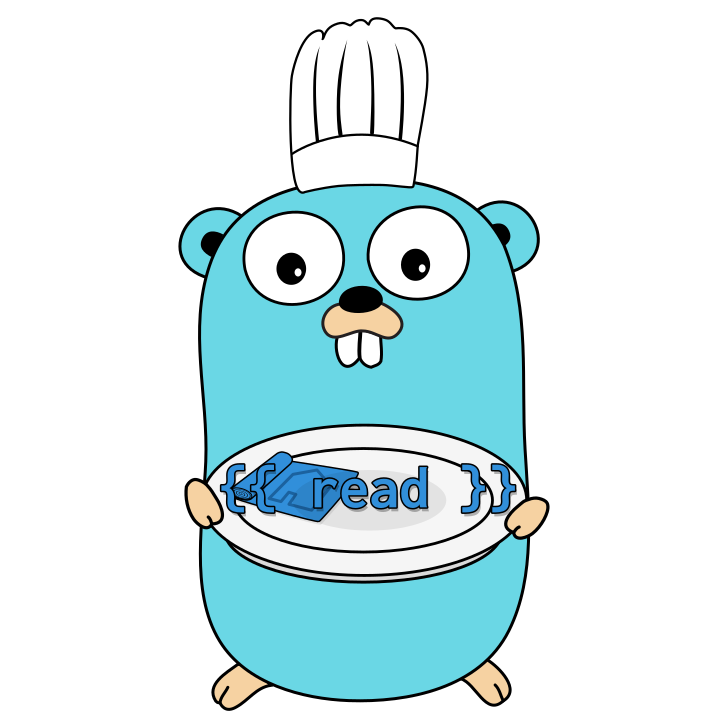
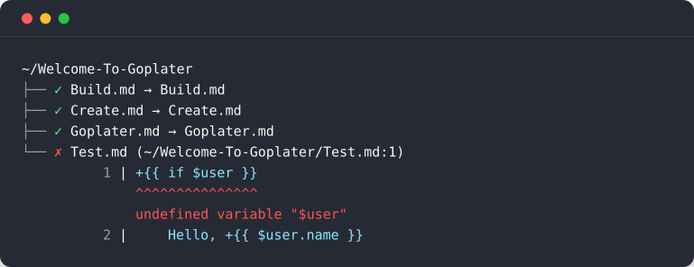
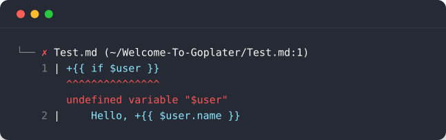

<!--
# The following comment will appear as empty,
# because it has already been consumed and processed by Goplater

# imports


# library commands


-->

<p align="center">
    
</p>

<h1 align="center">Goplater</h1>

<div align="center">
    <h3>Go templates with superpowers</h3>
    Read files, call APIs, parse JSON, YAML and Markdown and write your own template functions<br>
</div>

<br>

<div align="center">
    <a href="https://github.com/CodeShellDev/goplater/releases">
        
    </a>
    <a href="https://github.com/CodeShellDev/goplater/stargazers">
    
    </a>
    <a href="https://matrix.to/#/#codeshelldev.oss.goplater:matrix.org">
        
    </a>
    <a href="./LICENSE">
        
    </a>
</div>

## See it in action

<!-- prettier-ignore -->
	
    
    

    

    
	
	
	


<p align="center">
    
</p>

**`TEMPLATE.md`**

<!-- prettier-ignore -->
```handlebars
+{{- $app := jsonDecode (readRaw "./package.json") -}}

# +{{ upper (index $app "name") }}

Version: +{{ index $app "version" }}

+{{ read "./install.md" }}
```

```bash
goplater template TEMPLATE.md -o README.md
```

**`README.md`**

```markdown
# MY-APP

Version: 1.2.3

## Install

Run `npm install my-app`
```

[This very README is generated with Goplater.](./.github/templates/README.template.md)


## Contents

<!-- prettier-ignore -->
- [Why Goplater?](#why-goplater)
- [Getting Started](#getting-started)
- [Usage](#usage)
- [Standard Library](#standard-library)
	- [fs](#fs)
	- [outputto](#outputto)
	- [funcs](#funcs)
	- [globals](#globals)
	- [import](#import)
	- [return](#return)
	- [types](#types)
	- [html](#html)
	- [markdown](#markdown)
	- [yaml](#yaml)
	- [container](#container)
	- [conversion](#conversion)
	- [debug](#debug)
	- [base64](#base64)
	- [hex](#hex)
	- [hash](#hash)
	- [http](#http)
	- [json](#json)
	- [formulas](#formulas)
	- [operators](#operators)
	- [regex](#regex)
	- [strings](#strings)
	- [test](#test)
- [Contributing](#contributing)
- [Support](#support)
- [License](#license)
- [Legal](#legal)

Need help? Come join our [Matrix Server](https://matrix.to/#/#codeshelldev.oss.goplater:matrix.org)!

## Why Goplater?

- **Familiar.** It is Go's [`text/template`](https://pkg.go.dev/text/template) syntax. If you know it, you already know Goplater.
- **Easy debugging.** See what's wrong and where, with clear errors and [helpful context](#reading-errors).
- **Batteries included.** Read and write files, fetch URLs, work with JSON, YAML, HTML and Markdown, run regex and string operations. See the [Standard Library](#standard-library).
- **Write your own functions, inside the template.** Define them with `define`, call them with `call`. Arguments and return values included.
- **Share and import functions.** Put your functions in a file, import them from disk or from a URL and reuse them everywhere.
- **Not just a CLI.** The engine behind it, `gplt`, is a separate library you can embed in your own Go program.
- **Modular.** The library is split into independent modules. Load only what you need. Or let the CLI load them all.
- **Automated.** Use the [GitHub Action and Bot](https://github.com/CodeShellDev/goplater-action) to render templates and automate pull requests. See [Automation](#automate-with-github-actions).

## Getting Started

Install with Go:

```bash
go install github.com/codeshelldev/goplater@latest
```

Or download the latest binary from the [Releases page](https://github.com/CodeShellDev/goplater/releases), make it executable with `chmod +x goplater` and run it.

Template your first file:

```bash
goplater template examples/app-readme/template.md -o README.md
```

This creates `README.md` in your current working directory.

## Usage

### Templating files


Goplater uses Go's [built-in templating library](https://pkg.go.dev/text/template), with actions written as `+{{ ... }}`. Files that already contain plain `{{ }}` (Helm charts, GitHub Actions, Mustache) pass through untouched.

<!-- prettier-ignore -->
```handlebars
File Content: +{{ read "./myfile.txt" }}
```


### Whole folders

Point Goplater at a directory and it mirrors the structure into the output:

```bash
goplater template ./examples -o ./out -r
```

Useful flags:

| Flag                     | What it does                                                       |
| ------------------------ | ------------------------------------------------------------------ |
| `-o`                     | Output file or directory                                           |
| `-s`                     | Source directory for `~/` paths                                    |
| `-r`                     | Walk directories                                                   |
| `--match`                | Only template files matching a regex                               |
| `--flatten`              | Drop the directory structure                                       |
| `--root`                 | Choose the root that output paths are relative to                  |
| `--allowed-outputs`      | Limit where templates may write                                    |
| `--trim-max-blank-lines` | Experimental: Remove blank lines left behind by non-output actions |
| `--dry-run`              | Show what would be written, change nothing                         |
| `--ignore-errors`        | Continue processing when errors occur                              |

### Your own functions

Define a function in the template and call it:


<!-- prettier-ignore -->
```handlebars
+{{ define "greet(name, surname?)" }}
    +{{ $name := .name }}
    +{{ if .surname }}
        +{{ $name = concat .name " " .surname }}
    +{{ end }}
    +{{ return (printf "Hello, %s!" $name) }}
+{{ end }}

+{{ call "greet" "Gopher" }}
+{{ call "greet" "John" "Doe" }}
```


Output:

<!-- prettier-ignore -->
```handlebars
Hello, Gopher!
Hello, John Doe!
```

The `define` name is the function signature. Parameters are available as `.name` inside the function:

- `name` is required
- `name?` is optional (`nil` if not given)
- `...name` collects all remaining arguments into a slice

Optional and variadic parameters must come last. A `define` without a signature (e.g. `define "test"`) is a plain template and can't be called with `call`.

Prefer Go? Register custom Go functions as well.


### Share functions

Keep your functions in one file and import them from the filesystem or from a URL:


<!-- prettier-ignore -->
```handlebars
+{{ import "funcs" "https://raw.githubusercontent.com/CodeShellDev/goplater/refs/heads/main/examples/funcs" }}
+{{ call "funcs.greet" "John" }}
```


Pin remote imports to a tag or a commit and treat them like any other dependency: imported functions run inside your template.


### Reading errors

When a template fails, Goplater shows what went wrong and where.

<!-- prettier-ignore -->
	
    
    

    

    
	
	
	


<p align="center">
    
</p>

Every error comes with:

| Part     | What it shows                                             |
| -------- | --------------------------------------------------------- |
| Location | File, line and column where it happened                   |
| Context  | The failing line and the lines around it                  |
| Pointer  | `^` under the exact expression that failed                |
| Message  | What went wrong, like an undefined variable or a bad type |

Errors in imported files or `call`ed functions point to the file that holds the failing code.

Goplater stops at the first error. Use `--ignore-errors` to report it and keep going with the remaining files.

### Use the engine instead

`gplt`, Goplater's underlying templating engine, is not tied to the CLI.
Load the modules you want and embed templating in your own Go application.
Browse the packages on [pkg.go.dev](https://pkg.go.dev/github.com/CodeShellDev/goplater/pkg/gplt).

## Automate with GitHub Actions

Use Goplater in your CI/CD workflows to generate files automatically.

- **[Goplater GitHub Action](https://github.com/CodeShellDev/goplater-action)**: render templates directly in your GitHub Actions workflows.
- **[Goplater Bot](https://github.com/CodeShellDev/goplater-action/blob/main/.github/workflows/goplater-bot.yml)**: automate file generation in a repository and have the results submitted as a pull request or pushed as a commit.

We use [Goplater Bot](https://github.com/CodeShellDev/goplater-action/blob/main/.github/workflows/goplater-bot.yml) as well, check him out [PR #20](https://github.com/CodeShellDev/goplater/pull/20)!

## Standard Library

The `gplt` engine includes a large and growing selection of built-in functions for use in your templates.
Every module is independent, load all of them or only the ones you need.

Goplater ships with all implemented modules in addition to `fs`-specific and cli dependent functions.

| Module                        | Use it for                                         |
| ----------------------------- | -------------------------------------------------- |
| `fs`                          | Reading, writing and walking files and directories |
| `outputto`                    | Choosing the output path from inside a template    |
| `strings`, `regex`            | Trimming, splitting, replacing, matching           |
| `json`, `yaml`                | Decoding and encoding structured data              |
| `html`, `markdown`            | Querying and editing documents                     |
| `http`                        | Fetching remote resources                          |
| `math`                        | Operators and number helpers                       |
| `container`                   | Maps and slices                                    |
| `base64`, `conversion`        | Encoding and type conversion                       |
| `import`, `return`, `globals` | Sharing functions and passing values around        |
| `debug`                       | Printing while you develop                         |

Need something that is not there? Add your own with a custom module or your own Goplater function file and share it.

<h3><a href="https://github.com/codeshelldev/goplater/blob/main/internals/template/funcs/fs.go">fs</a></h3>


<table width="100%">
<tr><th align="left"><h4><code>read(path string) (string, throws error)</code></h4></th>
</tr><tr><td>
<p>Reads and templates file.</p>


<details>
  <summary>Examples</summary>
  <br/>

**Example**:
```handlebars
+{{ read "/path/to/file" }}
```

</details>

</td></tr></table>


<table width="100%">
<tr><th align="left"><h4><code>readRaw(path string) (string, throws error)</code></h4></th>
</tr><tr><td>
<p>Reads file (without templating).</p>


<details>
  <summary>Examples</summary>
  <br/>

**Example**:
```handlebars
+{{ readRaw "/path/to/file" }}
```

</details>

</td></tr></table>


<table width="100%">
<tr><th align="left"><h4><code>readArgs(path string, args any) (string, throws error)</code></h4></th>
</tr><tr><td>
<p>Reads file and passes arguments to it.
Arguments are available as <code>.arg</code> in the file being read.</p>


<details>
  <summary>Examples</summary>
  <br/>

**Example**:
```handlebars
+{{ readArgs "/path/to/file" (list "my" "args") }}
```

</details>

</td></tr></table>


<table width="100%">
<tr><th align="left"><h4><code>write(path string, content string) throws error</code></h4></th>
</tr><tr><td>
<p>Writes to a file path.</p>


<details>
  <summary>Examples</summary>
  <br/>

**Example**:
```handlebars
+{{ write "/path/to/file" "Hello" }}
```

</details>

</td></tr></table>


<table width="100%">
<tr><th align="left"><h4><code>mkdir(path string) throws error</code></h4></th>
</tr><tr><td>
<p>Creates directory at path.</p>


<details>
  <summary>Examples</summary>
  <br/>

**Example**:
```handlebars
+{{ mkdir "/path/to/somewhere/" }}
```

</details>

</td></tr></table>


<table width="100%">
<tr><th align="left"><h4><code>appendFile(path string, content string) throws error</code></h4></th>
</tr><tr><td>
<p>Appends to an existing file.</p>


<details>
  <summary>Examples</summary>
  <br/>

**Example**:
```handlebars
+{{ appendFile "/path/to/somewhere/" "Goodbye" }}
```

</details>

</td></tr></table>


<table width="100%">
<tr><th align="left"><h4><code>fsExists(path string) bool</code></h4></th>
</tr><tr><td>
<p>Returns if a file or folder exists at a given path.</p>


<details>
  <summary>Examples</summary>
  <br/>

**Example**:
```handlebars
+{{ if (fsExists "/path/to/somewhere") }}
Path exists!
+{{ end }}
```

</details>

</td></tr></table>


<table width="100%">
<tr><th align="left"><h4><code>isFile(path string) bool</code></h4></th>
</tr><tr><td>
<p>Returns if a file exists at a given path.</p>


<details>
  <summary>Examples</summary>
  <br/>

**Example**:
```handlebars
+{{ if (isFile "/path/to/file") }}
Path is a file!
+{{ end }}
```

</details>

</td></tr></table>


<table width="100%">
<tr><th align="left"><h4><code>isDir(path string) bool</code></h4></th>
</tr><tr><td>
<p>Returns if a folder exists at a given path.</p>


<details>
  <summary>Examples</summary>
  <br/>

**Example**:
```handlebars
+{{ if (isDir "/path/to/somewhere") }}
Path is a folder!
+{{ end }}
```

</details>

</td></tr></table>


<table width="100%">
<tr><th align="left"><h4><code>listDir(path string) ([]string, throws error)</code></h4></th>
</tr><tr><td>
<p>Returns all files and folders inside of a given directory.</p>


<details>
  <summary>Examples</summary>
  <br/>

**Example**:
```handlebars
+{{ join ", " (listDir "/path/to") }}
```
**Output**:
```
/path/to/file1.txt, /path/to/file2.txt, /path/to/folder
```


</details>

</td></tr></table>


<table width="100%">
<tr><th align="left"><h4><code>walkDir(path string) ([]string, throws error)</code></h4></th>
</tr><tr><td>
<p>Returns all files and folders recursively under a given directory.</p>


<details>
  <summary>Examples</summary>
  <br/>

**Example**:
```handlebars
+{{ join ", " (walkDir "/path/to") }}
```
**Output**:
```
/path/to/file1.txt, /path/to/file2.txt, /path/to/folder, /path/to/folder/file3.txt
```


</details>

</td></tr></table>


<table width="100%">
<tr><th align="left"><h4><code>fsRemove(path string) throws error</code></h4></th>
</tr><tr><td>
<p>Removes a file or folder at a given path.</p>


<details>
  <summary>Examples</summary>
  <br/>

**Example**:
```handlebars
+{{ fsRemove "/path/to/file/or/folder" }}
```

</details>

</td></tr></table>


<table width="100%">
<tr><th align="left"><h4><code>joinPath(paths []string) string</code></h4></th>
</tr><tr><td>
<p>Joins paths together.</p>


</td></tr></table>


<table width="100%">
<tr><th align="left"><h4><code>basePath(path string) string</code></h4></th>
</tr><tr><td>
<p>Returns the last element of a path.</p>


</td></tr></table>


<table width="100%">
<tr><th align="left"><h4><code>pathDir(path string) string</code></h4></th>
</tr><tr><td>
<p>Returns all but the last element of a path.</p>


</td></tr></table>


<table width="100%">
<tr><th align="left"><h4><code>fileExt(path string) string</code></h4></th>
</tr><tr><td>
<p>Returns the file name extension of a file path.</p>


</td></tr></table>


<table width="100%">
<tr><th align="left"><h4><code>absPath(path string) (string, throws error)</code></h4></th>
</tr><tr><td>
<p>Returns an absolute representation of a given path.
If the path is not absolute it will be joined with the current working directory to turn it into an absolute path.</p>


</td></tr></table>


<table width="100%">
<tr><th align="left"><h4><code>relPath(basePath string, targetPath string) (string, throws error)</code></h4></th>
</tr><tr><td>
<p>Returns a relative path that is lexically equivalent to targetPath when joined to basePath with an intervening separator.
The returned path will always be relative to basePath, even if basePath and targetPath share no elements.</p>


</td></tr></table>
<h3><a href="https://github.com/codeshelldev/goplater/blob/main/internals/template/funcs/outputto.go">outputto</a></h3>


<table width="100%">
<tr><th align="left"><h4><code>outputTo(path string) throws error</code></h4></th>
</tr><tr><td>
<p>Changes the output path for the current file.
Errors if path is not allowed.</p>


</td></tr></table>
<h3><a href="https://github.com/codeshelldev/goplater/blob/main/pkg/gplt/modules/core/funcs.go">funcs</a></h3>


<table width="100%">
<tr><th align="left"><h4><code>call(name string, args []any) (any, throws error)</code></h4></th>
</tr><tr><td>
<p>Calls a func by name with args, optionally with a namespace handle.
Fails if func is not accessible, undefined or has no signature.</p>
<p>Args are bound to the params of the func signature:</p>
<ul>
<li><code>name</code>: required, call fails if missing</li>
<li><code>name?</code>: optional (end only), <code>nil</code> if not given</li>
<li><code>...name</code>: variadic (last only), a slice of all remaining args</li>
</ul>
<p>Too many args fail unless the last param is variadic.</p>
<p>Result:</p>
<ul>
<li><code>return</code> not called (or called with no values): captured template output</li>
<li><code>return</code> with one value: that value</li>
<li><code>return</code> with multiple values: a slice of all values</li>
</ul>


<details>
  <summary>Examples</summary>
  <br/>

**Example**:
```handlebars
+{{ define "greet(name)" }}
+{{ echo (printf "Hello %s!" .name) }}
+{{ end }}
```
**Output**:
```
Hello John!
```


**Example**:
```handlebars
+{{ define "greet(name)" }}
Hello +{{ .name }}!
+{{ end }}
```
**Output**:
```
Hello John!
```


**Example**:
```handlebars
+{{ define "greet(name)" }}
+{{ return (printf "Hello %s!" .name) }}
+{{ end }}
```
**Output**:
```
Hello John!
```


</details>

</td></tr></table>
<h3><a href="https://github.com/codeshelldev/goplater/blob/main/pkg/gplt/modules/core/globals.go">globals</a></h3>


<table width="100%">
<tr><th align="left"><h4><code>globalSet(key string, value any) throws error</code></h4></th>
</tr><tr><td>
<p>Defines a global value with a key.</p>


</td></tr></table>


<table width="100%">
<tr><th align="left"><h4><code>globalGet(key string) (any, throws error)</code></h4></th>
</tr><tr><td>
<p>Tries to retrieve a global value with a key.</p>


</td></tr></table>


<table width="100%">
<tr><th align="left"><h4><code>globalHas(key string) bool</code></h4></th>
</tr><tr><td>
<p>Returns whether a given global variable exists.</p>


</td></tr></table>
<h3><a href="https://github.com/codeshelldev/goplater/blob/main/pkg/gplt/modules/core/import.go">import</a></h3>


<table width="100%">
<tr><th align="left"><h4><code>import(alias string?, path string) throws error</code></h4></th>
</tr><tr><td>
<p>Tries to import a template file with func definitions.
Optionally supply an alias for easier access.</p>
<p>The fs resolver is only available as an internal module and does not ship with <code>gplt</code>.</p>


<details>
  <summary>Examples</summary>
  <br/>

**Example**:
```handlebars
+{{ import "https://domain.com/functions" }}
```
**Output**:
```
+{{ call "functions.greet" "John" }}
```


**Example**:
```handlebars
+{{ import "funcs" "https://domain.com/functions" }}
```
**Output**:
```
+{{ call "funcs.greet" "John" }}
```


</details>

</td></tr></table>


<table width="100%">
<tr><th align="left"><h4><code>importExact(alias string?, path string, hash string?) throws error</code></h4></th>
</tr><tr><td>
<p>Same <code>import</code>, but only imports if content matches expected SHA-256 hash.</p>


<details>
  <summary>Examples</summary>
  <br/>

**Example**:
```handlebars
+{{ importExact "funcs" "https://domain.com/functions" "e3b0c44298fc1c149afbf4c8996fb92427ae41e4649b934ca495991b7852b855" }}
```
**Output**:
```
+{{ call "funcs.greet" "John" }}
```


</details>

</td></tr></table>
<h3><a href="https://github.com/codeshelldev/goplater/blob/main/pkg/gplt/modules/core/return.go">return</a></h3>


<table width="100%">
<tr><th align="left"><h4><code>return(values []any?)</code></h4></th>
</tr><tr><td>
<p>Sets output value(s).</p>


<details>
  <summary>Examples</summary>
  <br/>

**Example**:
```handlebars
+{{ return "a" "b" 1 2 }}
+{{ return (list "3" "4" "5") }}
```

</details>

</td></tr></table>


<table width="100%">
<tr><th align="left"><h4><code>getOutputs() []any</code></h4></th>
</tr><tr><td>
<p>Returns current outputs.</p>


</td></tr></table>
<h3><a href="https://github.com/codeshelldev/goplater/blob/main/pkg/gplt/modules/core/types.go">types</a></h3>


<table width="100%">
<tr><th align="left"><h4><code>typeOf(value any) (string, throws error)</code></h4></th>
</tr><tr><td>
<p>Returns the type of a value as a string (using <a href="https://pkg.go.dev/reflect#TypeOf">reflect.TypeOf</a>).</p>


</td></tr></table>


<table width="100%">
<tr><th align="left"><h4><code>isType(value any, typeName string) bool</code></h4></th>
</tr><tr><td>
<p>Reports whether value is of type (using <a href="https://pkg.go.dev/reflect#TypeOf">reflect.TypeOf</a>).</p>


</td></tr></table>
<h3><a href="https://github.com/codeshelldev/goplater/blob/main/pkg/gplt/modules/ext/html/html.go">html</a></h3>


<table width="100%">
<tr><th align="left"><h4><code>htmlDecode(html string) (*goquery.Document, throws error)</code></h4></th>
</tr><tr><td>
<p>Decodes html into a document.</p>


</td></tr></table>


<table width="100%">
<tr><th align="left"><h4><code>htmlDocFindAll(doc *goquery.Document, selector string) ([]*goquery.Selection, throws error)</code></h4></th>
</tr><tr><td>
<p>Finds elements in document by selector (using <a href="https://pkg.go.dev/github.com/PuerkitoBio/goquery#Selection.Find">goquery.Find</a>).</p>


</td></tr></table>


<table width="100%">
<tr><th align="left"><h4><code>htmlDocFind(doc *goquery.Document, selector string) (*goquery.Selection, throws error)</code></h4></th>
</tr><tr><td>
<p>Finds element in document by selector (using <a href="https://pkg.go.dev/github.com/PuerkitoBio/goquery#Selection.Find">goquery.Find</a>).</p>


</td></tr></table>


<table width="100%">
<tr><th align="left"><h4><code>htmlFindAll(doc *goquery.Document, selector string) ([]*goquery.Selection, throws error)</code></h4></th>
</tr><tr><td>
<p>Finds elements in element by selector (using <a href="https://pkg.go.dev/github.com/PuerkitoBio/goquery#Selection.Find">goquery.Find</a>).</p>


</td></tr></table>


<table width="100%">
<tr><th align="left"><h4><code>htmlFind(doc *goquery.Document, selector string) (*goquery.Selection, throws error)</code></h4></th>
</tr><tr><td>
<p>Finds element in element by selector (using <a href="https://pkg.go.dev/github.com/PuerkitoBio/goquery#Selection.Find">goquery.Find</a>).</p>


</td></tr></table>


<table width="100%">
<tr><th align="left"><h4><code>htmlText(el *goquery.Selection) string</code></h4></th>
</tr><tr><td>
<p>Returns the elements text content.</p>


</td></tr></table>


<table width="100%">
<tr><th align="left"><h4><code>htmlAttr(el *goquery.Selection, attr string) string</code></h4></th>
</tr><tr><td>
<p>Returns an elements attribute content.</p>


</td></tr></table>


<table width="100%">
<tr><th align="left"><h4><code>htmlInner(el *goquery.Selection) string</code></h4></th>
</tr><tr><td>
<p>Returns the elements inner html.</p>


</td></tr></table>
<h3><a href="https://github.com/codeshelldev/goplater/blob/main/pkg/gplt/modules/ext/markdown/markdown.go">markdown</a></h3>


<table width="100%">
<tr><th align="left"><h4><code>markdownDecode(md string) *Document</code></h4></th>
</tr><tr><td>
<p>Decodes markdown into a document.</p>


</td></tr></table>


<table width="100%">
<tr><th align="left"><h4><code>markdownEncode(doc *Document) string</code></h4></th>
</tr><tr><td>
<p>Encodes a document into markdown.</p>


</td></tr></table>


<table width="100%">
<tr><th align="left"><h4><code>markdownFindAll(target Searchable, selector string) []*Node</code></h4></th>
</tr><tr><td>
<p>Finds elements in target by selector (using <a href="https://pkg.go.dev/github.com/codeshelldev/goplater/pkg/gplt/modules/markdown#TypeMatches">custom</a>).</p>


</td></tr></table>


<table width="100%">
<tr><th align="left"><h4><code>markdownFind(target Searchable, selector string) *Node</code></h4></th>
</tr><tr><td>
<p>Finds element in target by selector (using <a href="https://pkg.go.dev/github.com/codeshelldev/goplater/pkg/gplt/modules/markdown#TypeMatches">custom</a>).</p>


</td></tr></table>


<table width="100%">
<tr><th align="left"><h4><code>markdownIs(node *Node, selector string) bool</code></h4></th>
</tr><tr><td>
<p>Returns whether node matches selector (using <a href="https://pkg.go.dev/github.com/codeshelldev/goplater/pkg/gplt/modules/markdown#TypeMatches">custom</a>).</p>


</td></tr></table>


<table width="100%">
<tr><th align="left"><h4><code>markdownHTML(doc *Document) (string, throws error)</code></h4></th>
</tr><tr><td>
<p>Returns html markdown representation.</p>


</td></tr></table>


<table width="100%">
<tr><th align="left"><h4><code>markdownText(node *Node) string</code></h4></th>
</tr><tr><td>
<p>Returns all raw markdown text in a node recursively.</p>


</td></tr></table>


<table width="100%">
<tr><th align="left"><h4><code>markdownHeadings(doc *Document) []*Heading</code></h4></th>
</tr><tr><td>
<p>Returns all markdown headings.</p>


</td></tr></table>


<table width="100%">
<tr><th align="left"><h4><code>markdownLinks(doc *Document) []*Link</code></h4></th>
</tr><tr><td>
<p>Returns all markdown links.</p>


</td></tr></table>


<table width="100%">
<tr><th align="left"><h4><code>markdownLinkURL(link *Link) string</code></h4></th>
</tr><tr><td>
<p>Returns the url of a markdown link node.</p>


</td></tr></table>


<table width="100%">
<tr><th align="left"><h4><code>markdownLinkSetURL(link *Link, url string)</code></h4></th>
</tr><tr><td>
<p>Sets a link node's url.</p>


</td></tr></table>


<table width="100%">
<tr><th align="left"><h4><code>markdownLinkSetTitle(link *Link, title string)</code></h4></th>
</tr><tr><td>
<p>Sets a link node's title.</p>


</td></tr></table>


<table width="100%">
<tr><th align="left"><h4><code>markdownLinkText(link *Link) string</code></h4></th>
</tr><tr><td>
<p>Returns the text of a markdown link node.</p>


</td></tr></table>


<table width="100%">
<tr><th align="left"><h4><code>markdownImages(doc *Document) []*Image</code></h4></th>
</tr><tr><td>
<p>Returns all markdown images.</p>


</td></tr></table>


<table width="100%">
<tr><th align="left"><h4><code>markdownImageURL(image *Image) string</code></h4></th>
</tr><tr><td>
<p>Returns the url of a markdown image node.</p>


</td></tr></table>


<table width="100%">
<tr><th align="left"><h4><code>markdownImageSetURL(image *Image, url string)</code></h4></th>
</tr><tr><td>
<p>Sets a image node's url.</p>


</td></tr></table>


<table width="100%">
<tr><th align="left"><h4><code>markdownImageSetAlt(image *Image, alt string)</code></h4></th>
</tr><tr><td>
<p>Sets a image node's alt.</p>


</td></tr></table>


<table width="100%">
<tr><th align="left"><h4><code>markdownParagraphs(doc *Document) []*Paragraph</code></h4></th>
</tr><tr><td>
<p>Returns all markdown paragraphs.</p>


</td></tr></table>


<table width="100%">
<tr><th align="left"><h4><code>markdownCodeBlocks(doc *Document) []*CodeBlock</code></h4></th>
</tr><tr><td>
<p>Returns all markdown code blocks.</p>


</td></tr></table>


<table width="100%">
<tr><th align="left"><h4><code>markdownBlockquotes(doc *Document) []*Blockquote</code></h4></th>
</tr><tr><td>
<p>Returns all markdown block quotes.</p>


</td></tr></table>


<table width="100%">
<tr><th align="left"><h4><code>markdownRemove(node *Node)</code></h4></th>
</tr><tr><td>
<p>Removes a markdown node.</p>


</td></tr></table>


<table width="100%">
<tr><th align="left"><h4><code>markdownAppend(doc *Document, str string)</code></h4></th>
</tr><tr><td>
<p>Appends text to a markdown document.</p>


</td></tr></table>


<table width="100%">
<tr><th align="left"><h4><code>markdownPrepend(doc *Document, str string)</code></h4></th>
</tr><tr><td>
<p>Prepends text to a markdown document.</p>


</td></tr></table>
<h3><a href="https://github.com/codeshelldev/goplater/blob/main/pkg/gplt/modules/ext/yaml/yaml.go">yaml</a></h3>


<table width="100%">
<tr><th align="left"><h4><code>yamlEncode(obj any) (string, throws error)</code></h4></th>
</tr><tr><td>
<p>Encodes an object into a yaml string.</p>


</td></tr></table>


<table width="100%">
<tr><th align="left"><h4><code>yamlDecode(yaml string) (any, throws error)</code></h4></th>
</tr><tr><td>
<p>Decodes a yaml string into an object.</p>


</td></tr></table>
<h3><a href="https://github.com/codeshelldev/goplater/blob/main/pkg/gplt/modules/std/container/container.go">container</a></h3>


<table width="100%">
<tr><th align="left"><h4><code>delete(container map|slice, key any) (any, throws error)</code></h4></th>
</tr><tr><td>
<p>Deletes a container entry with the given key (mutates maps, but must return modified slice).</p>


<details>
  <summary>Examples</summary>
  <br/>

**Example**:
```handlebars
+{{ $slice := list "Apple" "Banana" }}
+{{ $newSlice := delete $slice 0 }}
+{{ echo $newSlice }}
```
**Output**:
```
[Banana]
```


**Example**:
```handlebars
+{{ $map := dict "key1" "value1" "key2" "value2" }}
+{{ delete $map "key1" }}
+{{ echo $map }}
```
**Output**:
```
map[key2:value2]
```


</details>

</td></tr></table>


<table width="100%">
<tr><th align="left"><h4><code>set(container map|slice, key any, value any) throws error</code></h4></th>
</tr><tr><td>
<p>Set a container entry value with the given key.</p>


<details>
  <summary>Examples</summary>
  <br/>

**Example**:
```handlebars
+{{ $slice := list "Apple" "Banana" }}
+{{ set $slice 0 "Strawberry" }}
+{{ echo $slice }}
```
**Output**:
```
[Strawberry Banana]
```


</details>

</td></tr></table>


<table width="100%">
<tr><th align="left"><h4><code>hasKey(container map|slice, key any) (bool, throws error)</code></h4></th>
</tr><tr><td>
<p>Returns if an entry with the given key exists in container.</p>


<details>
  <summary>Examples</summary>
  <br/>

**Example**:
```handlebars
+{{ if (hasKey (list "version" "v1") "version") }}
Container has "version"!
+{{ end }}
```

</details>

</td></tr></table>


<table width="100%">
<tr><th align="left"><h4><code>includes(container map|slice, value any) (bool, throws error)</code></h4></th>
</tr><tr><td>
<p>Returns if an entry with the given value exists in container.</p>


<details>
  <summary>Examples</summary>
  <br/>

**Example**:
```handlebars
+{{ if (includes (list "version" "v1") "v1") }}
Container includes "v1"!
+{{ end }}
```

</details>

</td></tr></table>


<table width="100%">
<tr><th align="left"><h4><code>append(container []any, value any) []any</code></h4></th>
</tr><tr><td>
<p>Appends a value to a slice (returns a new copy).</p>


<details>
  <summary>Examples</summary>
  <br/>

**Example**:
```handlebars
+{{ $slice := list "Apple" "Banana" }}
+{{ $newSlice = append $slice "Strawberry" }}
+{{ echo $newSlice }}
```
**Output**:
```
[Apple Banana Strawberry]
```


</details>

</td></tr></table>


<table width="100%">
<tr><th align="left"><h4><code>list(values []any) []any</code></h4></th>
</tr><tr><td>
<p>Creates a new slice, optionally with values.</p>


<details>
  <summary>Examples</summary>
  <br/>

**Example**:
```handlebars
+{{ $slice := list "Apple" "Banana" }}
+{{ echo $slice }}
```
**Output**:
```
[Apple Banana]
```


</details>

</td></tr></table>


<table width="100%">
<tr><th align="left"><h4><code>dict(entries []any) (map[string]any, errors)</code></h4></th>
</tr><tr><td>
<p>Creates a new map, optionally with key value pairs.</p>
<p>Pairs are constructed one by one, a key followed by the given value.</p>
<p>Currently only supports string keys!</p>


<details>
  <summary>Examples</summary>
  <br/>

**Example**:
```handlebars
+{{ $map := dict "key1" "value1" "key2" "value2" }}
+{{ echo $map }}
```
**Output**:
```
map[key1:value1 key2:value2]
```


</details>

</td></tr></table>
<h3><a href="https://github.com/codeshelldev/goplater/blob/main/pkg/gplt/modules/std/conversion/conversion.go">conversion</a></h3>


<table width="100%">
<tr><th align="left"><h4><code>toString(value any) string</code></h4></th>
</tr><tr><td>
<p>Returns a given value as string (using <a href="https://pkg.go.dev/fmt#Sprint">fmt.Sprint</a>, bytes are handled separately).</p>


</td></tr></table>


<table width="100%">
<tr><th align="left"><h4><code>toBytes(str string) []byte</code></h4></th>
</tr><tr><td>
<p>Turns a string into bytes.</p>


</td></tr></table>


<table width="100%">
<tr><th align="left"><h4><code>toInt(str string) (int, throws error)</code></h4></th>
</tr><tr><td>
<p>Attempts to parse a string as int.</p>


</td></tr></table>


<table width="100%">
<tr><th align="left"><h4><code>toFloat64(str string) (float64, throws error)</code></h4></th>
</tr><tr><td>
<p>Attempts to parse a string as float64.</p>


</td></tr></table>


<table width="100%">
<tr><th align="left"><h4><code>toFloat32(str string) (float32, throws error)</code></h4></th>
</tr><tr><td>
<p>Attempts to parse a string as float32.</p>


</td></tr></table>


<table width="100%">
<tr><th align="left"><h4><code>toBool(str string) (bool, throws error)</code></h4></th>
</tr><tr><td>
<p>Attempts to parse a string as a bool (using <a href="https://pkg.go.dev/strconv#ParseBool">strconv.ParseBool</a>).</p>


</td></tr></table>
<h3><a href="https://github.com/codeshelldev/goplater/blob/main/pkg/gplt/modules/std/debug/debug.go">debug</a></h3>


<table width="100%">
<tr><th align="left"><h4><code>echo(data []any)</code></h4></th>
</tr><tr><td>
<p>Outputs data to stdout.</p>


</td></tr></table>
<h3><a href="https://github.com/codeshelldev/goplater/blob/main/pkg/gplt/modules/std/encoding/base64.go">base64</a></h3>


<table width="100%">
<tr><th align="left"><h4><code>base64Encode(str string) string</code></h4></th>
</tr><tr><td>
<p>Encodes strings with base64.</p>


</td></tr></table>


<table width="100%">
<tr><th align="left"><h4><code>base64Decode(str string) (string, throws error)</code></h4></th>
</tr><tr><td>
<p>Decodes a base64 string.</p>


</td></tr></table>
<h3><a href="https://github.com/codeshelldev/goplater/blob/main/pkg/gplt/modules/std/encoding/hex.go">hex</a></h3>


<table width="100%">
<tr><th align="left"><h4><code>hexEncode(str string) string</code></h4></th>
</tr><tr><td>
<p>Encodes a string as hex.</p>


</td></tr></table>


<table width="100%">
<tr><th align="left"><h4><code>hexDecode(str string) (string, throws error)</code></h4></th>
</tr><tr><td>
<p>Decodes a string as hex.</p>


</td></tr></table>
<h3><a href="https://github.com/codeshelldev/goplater/blob/main/pkg/gplt/modules/std/hash/hash.go">hash</a></h3>


<table width="100%">
<tr><th align="left"><h4><code>hash(str string)</code></h4></th>
</tr><tr><td>
<p>Hashes a given string with SHA-256.</p>


</td></tr></table>


<table width="100%">
<tr><th align="left"><h4><code>sha1(str string)</code></h4></th>
</tr><tr><td>
<p>Hashes a given string with SHA-1.</p>


</td></tr></table>


<table width="100%">
<tr><th align="left"><h4><code>sha512(str string)</code></h4></th>
</tr><tr><td>
<p>Hashes a given string with SHA-512.</p>


</td></tr></table>


<table width="100%">
<tr><th align="left"><h4><code>md5(str string)</code></h4></th>
</tr><tr><td>
<p>Hashes a given string with MD-5.</p>


</td></tr></table>
<h3><a href="https://github.com/codeshelldev/goplater/blob/main/pkg/gplt/modules/std/http/http.go">http</a></h3>


<table width="100%">
<tr><th align="left"><h4><code>fetch(url string) (string, throws error)</code></h4></th>
</tr><tr><td>
<p>Fetches a resource from a given url.
Outputs errors as string.</p>


</td></tr></table>
<h3><a href="https://github.com/codeshelldev/goplater/blob/main/pkg/gplt/modules/std/json/json.go">json</a></h3>


<table width="100%">
<tr><th align="left"><h4><code>jsonEncode(obj any) (string, throws error)</code></h4></th>
</tr><tr><td>
<p>Encodes an object into a json string.</p>


</td></tr></table>


<table width="100%">
<tr><th align="left"><h4><code>jsonDecode(json string) (any, throws error)</code></h4></th>
</tr><tr><td>
<p>Decodes a json string into an object.</p>


</td></tr></table>
<h3><a href="https://github.com/codeshelldev/goplater/blob/main/pkg/gplt/modules/std/math/formulas.go">formulas</a></h3>


<table width="100%">
<tr><th align="left"><h4><code>abs(numbers int|float64) (int|float64, throws error)</code></h4></th>
</tr><tr><td>
<p>Returns the abs value of a number.</p>


</td></tr></table>


<table width="100%">
<tr><th align="left"><h4><code>min(a int|float64, b int|float64) (int|float64, throws error)</code></h4></th>
</tr><tr><td>
<p>Returns the smaller value of two numbers.</p>


</td></tr></table>


<table width="100%">
<tr><th align="left"><h4><code>max(a int|float64, b int|float64) (int|float64, throws error)</code></h4></th>
</tr><tr><td>
<p>Returns the bigger value of two numbers.</p>


</td></tr></table>


<table width="100%">
<tr><th align="left"><h4><code>clamp(value int|float64, min int|float64, max int|float64) (int|float64, throws error)</code></h4></th>
</tr><tr><td>
<p>Clamps a value between a minimum and maximum value.</p>


</td></tr></table>


<table width="100%">
<tr><th align="left"><h4><code>pow(base int|float64, exponent int|float64) (float64, throws error)</code></h4></th>
</tr><tr><td>
<p>Performs pow on base with exponent.</p>


</td></tr></table>


<table width="100%">
<tr><th align="left"><h4><code>sqrt(number int|float64) (float64, throws error)</code></h4></th>
</tr><tr><td>
<p>Returns the square root of a number.</p>


</td></tr></table>


<table width="100%">
<tr><th align="left"><h4><code>round(number int|float64, digits int?) (int, throws error)</code></h4></th>
</tr><tr><td>
<p>Rounds a number to the specified number of decimal digits (default: 0).</p>


</td></tr></table>


<table width="100%">
<tr><th align="left"><h4><code>floor(number int|float64) (int, throws error)</code></h4></th>
</tr><tr><td>
<p>Returns the greatest integer value less than or equal to number.</p>


</td></tr></table>


<table width="100%">
<tr><th align="left"><h4><code>ceil(number int|float64) (int, throws error)</code></h4></th>
</tr><tr><td>
<p>Returns the least integer value greater than or equal to number.</p>


</td></tr></table>
<h3><a href="https://github.com/codeshelldev/goplater/blob/main/pkg/gplt/modules/std/math/operators.go">operators</a></h3>


<table width="100%">
<tr><th align="left"><h4><code>add(numbers [](int|float64)) (int|float64, throws error)</code></h4></th>
</tr><tr><td>
<p>Adds numbers together.</p>


</td></tr></table>


<table width="100%">
<tr><th align="left"><h4><code>sub(numbers [](int|float64)) (int|float64, throws error)</code></h4></th>
</tr><tr><td>
<p>Subtracts numbers from each other.</p>


</td></tr></table>


<table width="100%">
<tr><th align="left"><h4><code>mul(numbers [](int|float64)) (int|float64, throws error)</code></h4></th>
</tr><tr><td>
<p>Multiplies numbers together.</p>


</td></tr></table>


<table width="100%">
<tr><th align="left"><h4><code>div(numbers [](int|float64)) (int|float64, throws error)</code></h4></th>
</tr><tr><td>
<p>Divides numbers from each other.</p>


</td></tr></table>


<table width="100%">
<tr><th align="left"><h4><code>mod(numbers [](int|float64)) (int|float64, throws error)</code></h4></th>
</tr><tr><td>
<p>Performs modulo on numbers.</p>


</td></tr></table>
<h3><a href="https://github.com/codeshelldev/goplater/blob/main/pkg/gplt/modules/std/regex/regex.go">regex</a></h3>


<table width="100%">
<tr><th align="left"><h4><code>regexMatch(regex string, str string) (bool, throws error)</code></h4></th>
</tr><tr><td>
<p>Returns whether a string matches the given regex pattern.</p>


</td></tr></table>


<table width="100%">
<tr><th align="left"><h4><code>regexFindAll(regex string, str string, n int?) ([]string, throws error)</code></h4></th>
</tr><tr><td>
<p>Returns all (optionally up to n) matches against the given regex pattern in a string.</p>


</td></tr></table>


<table width="100%">
<tr><th align="left"><h4><code>regexFindGroups(regex string, str string) ([][]string, throws error)</code></h4></th>
</tr><tr><td>
<p>Returns all matches and submatches from the given regex pattern in a string.</p>


</td></tr></table>


<table width="100%">
<tr><th align="left"><h4><code>regexFindGroupsIndex(regex string, str string) ([][]int, throws error)</code></h4></th>
</tr><tr><td>
<p>Returns all match and submatch positions from the given regex pattern in a string.</p>


</td></tr></table>


<table width="100%">
<tr><th align="left"><h4><code>regexReplaceAll(str string, regex string, new string) (string, throws error)</code></h4></th>
</tr><tr><td>
<p>Replaces all matches from the given regex pattern in a string with new (which for allows using '$1', etc.).</p>


</td></tr></table>
<h3><a href="https://github.com/codeshelldev/goplater/blob/main/pkg/gplt/modules/std/strings/strings.go">strings</a></h3>


<table width="100%">
<tr><th align="left"><h4><code>trimSpace(str string) string</code></h4></th>
</tr><tr><td>
<p>Trims space from a string (leading and trailing).</p>


</td></tr></table>


<table width="100%">
<tr><th align="left"><h4><code>trim(str string, cutset string) string</code></h4></th>
</tr><tr><td>
<p>Trims all chars defined in the cutset param from a string (leading and trailing).</p>


</td></tr></table>


<table width="100%">
<tr><th align="left"><h4><code>upper(str string) string</code></h4></th>
</tr><tr><td>
<p>Uppercases a string.</p>


</td></tr></table>


<table width="100%">
<tr><th align="left"><h4><code>lower(str string) string</code></h4></th>
</tr><tr><td>
<p>Lowercases a string.</p>


</td></tr></table>


<table width="100%">
<tr><th align="left"><h4><code>contains(str string, sub string) bool</code></h4></th>
</tr><tr><td>
<p>Returns whether a string contains the given substring.</p>


</td></tr></table>


<table width="100%">
<tr><th align="left"><h4><code>count(str string, sub string) int</code></h4></th>
</tr><tr><td>
<p>Counts all occurences of a substring in the given string.</p>


</td></tr></table>


<table width="100%">
<tr><th align="left"><h4><code>hasPrefix(str string, prefix string) bool</code></h4></th>
</tr><tr><td>
<p>Returns whether a string starts with the given prefix.</p>


</td></tr></table>


<table width="100%">
<tr><th align="left"><h4><code>hasSuffix(str string, suffix string) bool</code></h4></th>
</tr><tr><td>
<p>Returns whether a string ends with the given suffix.</p>


</td></tr></table>


<table width="100%">
<tr><th align="left"><h4><code>isEmpty(str string) bool</code></h4></th>
</tr><tr><td>
<p>Returns whether the given string is empty.</p>


</td></tr></table>


<table width="100%">
<tr><th align="left"><h4><code>replace(str string, old string, new string) string</code></h4></th>
</tr><tr><td>
<p>Replaces all occurences of old with new.</p>


</td></tr></table>


<table width="100%">
<tr><th align="left"><h4><code>split(str string, sep string) []string</code></h4></th>
</tr><tr><td>
<p>Split a string by the given seperator.</p>


</td></tr></table>


<table width="100%">
<tr><th align="left"><h4><code>after(str string, sub string) string</code></h4></th>
</tr><tr><td>
<p>Returns the string after the given substring in a string.</p>


</td></tr></table>


<table width="100%">
<tr><th align="left"><h4><code>afterLast(str string, sub string) string</code></h4></th>
</tr><tr><td>
<p>Returns the string after the last occurrence of the given substring.</p>


</td></tr></table>


<table width="100%">
<tr><th align="left"><h4><code>before(str string, sub string) string</code></h4></th>
</tr><tr><td>
<p>Returns the string before the given substring in a string.</p>


</td></tr></table>


<table width="100%">
<tr><th align="left"><h4><code>beforeLast(str string, sub string) string</code></h4></th>
</tr><tr><td>
<p>Returns the string before the last occurrence of the given substring.</p>


</td></tr></table>


<table width="100%">
<tr><th align="left"><h4><code>between(str string, startSub string, endSub string) string</code></h4></th>
</tr><tr><td>
<p>Returns the substring between the start and end substring.</p>


</td></tr></table>


<table width="100%">
<tr><th align="left"><h4><code>trimPrefix(str string, sub string) string</code></h4></th>
</tr><tr><td>
<p>Removes a substring at the start of the given string.</p>


</td></tr></table>


<table width="100%">
<tr><th align="left"><h4><code>trimSuffix(str string, sub string) string</code></h4></th>
</tr><tr><td>
<p>Removes a substring at the end of the given string.</p>


</td></tr></table>


<table width="100%">
<tr><th align="left"><h4><code>substr(str string, start int, end int) string</code></h4></th>
</tr><tr><td>
<p>Slices a string based on start and end index.</p>


</td></tr></table>


<table width="100%">
<tr><th align="left"><h4><code>join(sep string, strs []string) string</code></h4></th>
</tr><tr><td>
<p>Joins multiple strings together by the given separator.</p>


</td></tr></table>


<table width="100%">
<tr><th align="left"><h4><code>repeat(str string, count int) string</code></h4></th>
</tr><tr><td>
<p>Repeat a string n times.</p>


</td></tr></table>


<table width="100%">
<tr><th align="left"><h4><code>concat(strs []string) string</code></h4></th>
</tr><tr><td>
<p>Concat strings together (join without sep).</p>


</td></tr></table>
<h3><a href="https://github.com/codeshelldev/goplater/blob/main/pkg/gplt/modules/test/test.go">test</a></h3>


<table width="100%">
<tr><th align="left"><h4><code>emit(label string?, value any) throws error</code></h4></th>
</tr><tr><td>
<p>Records a value, optionally with a label.</p>
<p>Not bundled with goplater, used internally for unit and integration tests.</p>


</td></tr></table>


## Contributing

Found a bug or just want to change or add something?
Feel free to open up an issue or a PR!

## Support

Like this Project? Or just want to help?
Why not ⭐️ this Repo? :)

## License

This Project is licensed under the [MIT License](./LICENSE).

## Legal

Logo designed by [@CodeShellDev](https://github.com/CodeShellDev). All rights reserved for original design contributions.

Go gopher mascot originally created by [Renée French](https://instagram.com/reneefrench/),
used and adapted under the [CC BY 4.0](https://creativecommons.org/licenses/by/4.0/) license.
